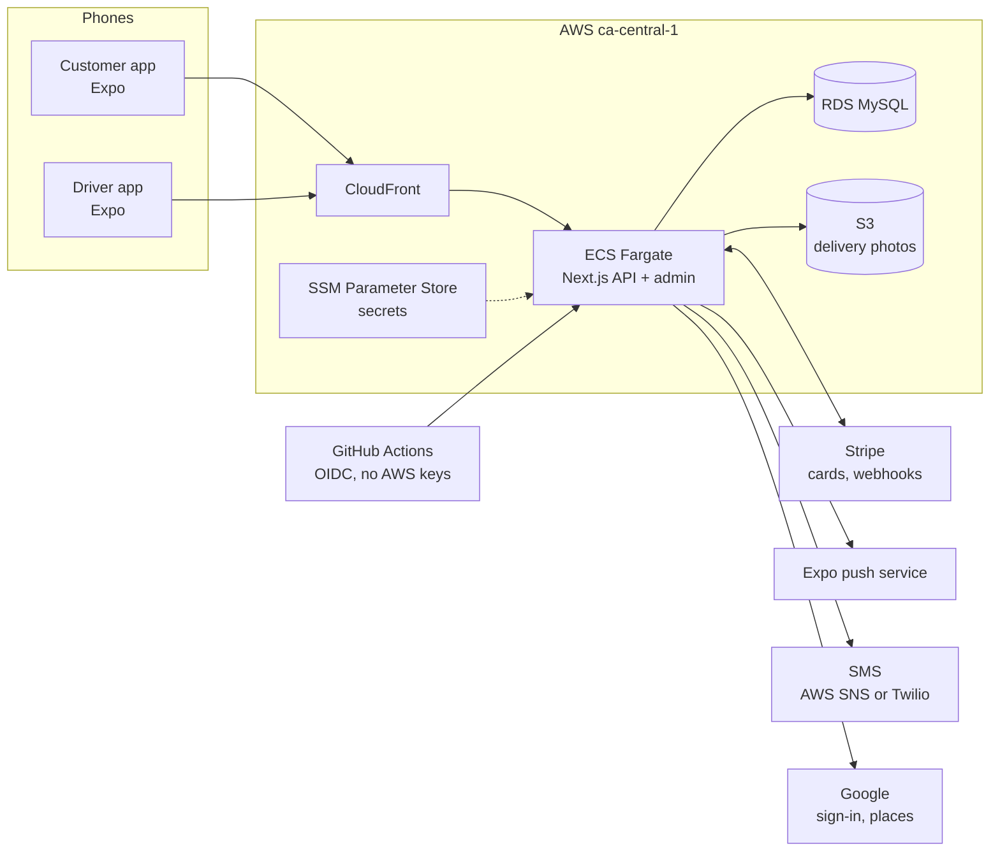

# Rabbit: backend

**Grocery delivery in Ottawa.** Customers order from a nearby store in the [customer app](https://github.com/mertmetin/rabbit-app); a driver shops the basket by hand and delivers it, following the order in the [driver app](https://github.com/mertmetin/rabbit-driver). This repo is the backend that runs both: a TypeScript API, an admin dashboard, payments and notifications, deployed on AWS.

| Repo | What it is |
|---|---|
| **rabbit-server** (this repo) | Next.js API + admin dashboard, Prisma/MySQL, Stripe, AWS ECS |
| [rabbit-app](https://github.com/mertmetin/rabbit-app) | Customer app, React Native (Expo) |
| [rabbit-driver](https://github.com/mertmetin/rabbit-driver) | Driver app, React Native (Expo Router, TypeScript) |
| [rabbit-api](https://github.com/mertmetin/rabbit-api) | The 2020–21 Laravel API this backend replaced |

## Architecture



## What it does

**Ordering**
- **Sign-in:** phone number plus an SMS code, or Google sign-in. JWT sessions (`jose`), with rate limiting on code requests.
- **Stores and catalogue:** closest open store by distance, categories, product groups with variants (size, fat %, flavour), search, popular items, favourites and promotions. A starter catalogue of real Ottawa grocery products is loaded from CSV.
- **Live store status:** a server-sent events stream (`/api/stores/stream`) tells the app when a store opens or closes. A store is "open" while a driver is online there.
- **Checkout:** a quote endpoint prices the basket with provincial sales tax (basic groceries zero-rated) and the delivery-fee rules (first order free, free over $40, otherwise $3.99, $20 minimum, all configurable). It also gives a **delivery-time estimate** from a queue model: orders ahead, shopping time per product, and road-adjusted driving distance.
- **Payments:** Stripe saved cards (SetupIntents). The card is authorised at checkout and charged only for what the driver actually found, and tips can be added after delivery. Webhooks keep orders in sync, and a secured cron endpoint releases abandoned authorisations.

**Delivering**
- **Driver flow:** go online at a store, accept an order, mark what was found while shopping, pick up, share live location, and deliver with a required doorstep photo uploaded to S3.
- **Notifications:** Expo push to customers and drivers at every status change, plus SMS alerts to staff for new orders.
- **Tracking:** customers see the order's progress, rate the delivery and add to the tip afterwards.

**Running it**
- **Admin dashboard** (`/admin`, server-rendered, session login): live orders with auto-refresh, order detail, products and stock per store, and adding drivers.
- **Support:** in-app chat through Chatwoot, with identity verification by HMAC.

## Engineering

- **Stack:** Next.js 16 (App Router, route handlers, server actions), React 19, TypeScript, Prisma 7 with MySQL, Zod validation.
- **Data model:** 15 Prisma models (users, addresses, stores, categories, products and variants, inventory, promotions, orders and items, payment methods, push tokens, verification codes), with versioned migrations.
- **Tests:** 107 Vitest tests against a real MySQL database, covering auth, catalogue, ordering, payment webhooks, the driver flow, tips, push and SMS.
- **CI/CD:** GitHub Actions runs type-checking, lint and tests against MySQL. On `main` it builds the Docker image, pushes it to ECR and deploys to **ECS Fargate**. AWS access is through **OIDC**, so there are no AWS keys in GitHub.
- **Secrets:** every secret (database URL, JWT, Stripe, webhook and HMAC keys) is injected from **SSM Parameter Store** by the task definition; none are in the repo.
- **Deploys:** the container applies pending Prisma migrations at start-up, under a database lock so parallel starts are safe, over TLS to RDS.

## API overview

| Area | Endpoints |
|---|---|
| Auth | `POST /api/auth/start`, `/api/auth/verify`, `/api/auth/google`, `/api/logout` |
| Catalogue | `/api/stores`, `/api/stores/closest`, `/api/stores/stream`, `/api/stores/:id/categories`, `/products`, `/popular`, `/api/search`, `/api/promotions` |
| Account | `/api/user`, `/api/users/:id/addresses`, `/favorites`, `/api/user/push-token` |
| Orders | `/api/orders/quote`, `/api/orders`, `/api/orders/:id`, `/confirm`, `/cancel`, `/rating`, `/photo` |
| Payments | `/api/payment/setup`, `/api/payment/methods`, `/api/stripe/webhook` |
| Driver | `/api/driver/status`, `/api/driver/location`, `/api/driver/orders`, `/:id/accept`, `/shopped`, `/pickup`, `/photo`, `/deliver` |
| Ops | `/api/health`, `/api/cron/release-abandoned`, `/admin` |

## Run locally

```bash
npm ci
# .env: DATABASE_URL (MySQL), JWT_SECRET, SMS_PROVIDER=log,
#       STRIPE_SECRET_KEY / STRIPE_WEBHOOK_SECRET (test mode)
npx prisma migrate dev
npx tsx prisma/seed.ts          # demo stores, catalogue and users
npm run dev                     # http://localhost:3000
npm test                        # uses .env.test and a separate MySQL database
```

With `SMS_PROVIDER=log`, sign-in codes are printed to the console instead of being sent.

## History

Rabbit started in 2020 as a Laravel API ([rabbit-api](https://github.com/mertmetin/rabbit-api)) and a React Native app. In 2026 I rebuilt the backend in TypeScript on Next.js, ported the data model to Prisma, added the driver app, Stripe authorise-then-capture payments, live tracking and the AWS deployment.
